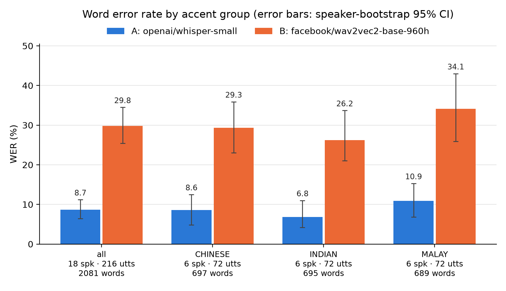
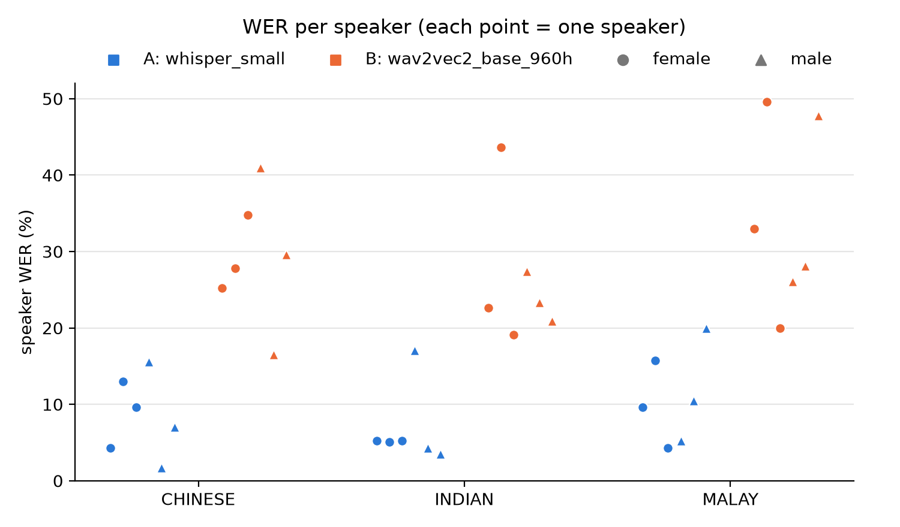

# Report — Does ASR work equally well across Singapore English accent groups?

*HG4052 Assignment 1, worked example. Pipeline and how to rerun it: [README.md](README.md).*

## Summary

- **Whisper small makes far fewer errors than wav2vec2-base-960h**: 8.7 % vs 29.8 % WER overall. The gap is
  21 points (95 % CI 17.9–24.6) and holds in every accent group.
- **Both systems rank the groups the same way**: Malay speakers highest, Indian speakers lowest. But with six
  speakers per group the confidence intervals overlap widely, so this test set **cannot show a reliable
  difference between accent groups**.
- **Speakers differ much more than groups do**: Whisper's WER ranges from 1.7 % to 20.0 % across speakers,
  and the range inside the Malay group alone (4.3–20.0 %) is larger than any gap between group means.
- **The errors differ in kind**: wav2vec2 mostly writes what it hears letter by letter, producing non-words
  (vowel and consonant confusions). Whisper mostly fails on the *-ed/-s* endings, proper names and rare words,
  and in a handful of clips (3 draft cases in 216) produced fluent text that was never said.

## 1. Design

| | |
|---|---|
| Corpus | IMDA National Speech Corpus, Part 1 (read speech), channel 0 |
| Comparison | Accent group (Chinese, Indian, Malay) × sex (F, M) |
| Held constant | Microphone (AKG C214 on channel 0), sentences, recording setting |
| Speakers | 3 per accent × sex cell, sampled with a fixed seed → 18 speakers |
| Sentences | 12 prompts read by all 18 speakers, none containing an unintelligible (`**`) stretch → 216 utterances, 2,081 reference words, about 16 minutes |
| System A | `openai/whisper-small`, English, transcribe task, greedy decoding |
| System B | `facebook/wav2vec2-base-960h`, greedy CTC, no language model |
| Metric | Corpus-level WER (errors ÷ reference words) after one shared text normaliser |
| Uncertainty | 95 % CIs from a bootstrap that resamples **speakers**, not utterances, since one speaker's sentences are not independent |

The speaker sheet records accent group, sex and microphone but **not age**, so age could not be controlled.
Because every speaker reads the same 12 sentences, differences between groups cannot come from the text.

The normaliser (step 2) was fixed before any system output was looked at. It lowercases, removes punctuation
and the corpus' non-speech tags (`<SPK/>`, `<NON/>`), spells numbers out, expands contractions, joins spelled
letters, removes filler words and maps UK to US spelling. The same function is applied to the references and
to both systems. Full settings: [`outputs/normaliser_config.json`](outputs/normaliser_config.json).

## 2. Results

### 2.1 By accent group

| Group | Speakers | Ref. words | WER A (Whisper) | 95 % CI | WER B (wav2vec2) | 95 % CI | A − B |
|---|---|---|---|---|---|---|---|
| **All** | 18 | 2,081 | **8.7** | 6.4–11.2 | **29.8** | 25.4–34.5 | −21.1 |
| Chinese | 6 | 697 | 8.6 | 4.8–12.5 | 29.3 | 23.0–35.9 | −20.7 |
| Indian | 6 | 695 | 6.8 | 4.2–11.0 | 26.2 | 21.0–33.7 | −19.4 |
| Malay | 6 | 689 | 10.9 | 6.8–15.3 | 34.1 | 25.9–43.0 | −23.2 |
| Female | 9 | 1,037 | 8.0 | 5.6–10.7 | 30.7 | 24.5–37.7 | −22.7 |
| Male | 9 | 1,044 | 9.5 | 5.4–13.8 | 29.0 | 23.1–35.3 | −19.5 |

Full table, including substitution/deletion/insertion rates and the accent × sex cells:
[`outputs/audit_table.csv`](outputs/audit_table.csv).

- For both systems most errors are **substitutions** (Whisper 6.6 of 8.7 points, wav2vec2 25.3 of 29.8).
- The **system difference is robust**: its CI excludes zero overall and in every group.
- The **group differences are not**: for Whisper, the Malay CI (6.8–15.3) overlaps the Indian CI (4.2–11.0)
  almost entirely. That both systems rank the groups the same way is suggestive, but six speakers per group
  cannot separate an accent effect from the effect of which six speakers happened to be drawn.
- There is **no sex difference** for either system (8.0 vs 9.5; 30.7 vs 29.0). The accent × sex cells have
  three speakers each and are descriptive only.

### 2.2 By speaker

Per-speaker WER ([`outputs/wer_by_speaker.csv`](outputs/wer_by_speaker.csv)) spreads widely in every group:

| Group | Whisper: lowest – highest speaker | wav2vec2: lowest – highest speaker |
|---|---|---|
| Chinese | 1.7 – 15.6 | 16.5 – 41.0 |
| Indian | 3.5 – 17.1 | 19.1 – 43.6 |
| Malay | 4.3 – 20.0 | 20.0 – 49.6 |

Speakers who are hard for one system tend to be hard for the other: the two highest wav2vec2 speakers
(49.6 %, 47.8 %) are also among the three highest for Whisper (15.7 %, 20.0 %). Individual voice and reading
style matter more here than the accent label, which is why the bootstrap resamples speakers.

### 2.3 By sentence

Per-sentence WER ([`outputs/wer_by_prompt.csv`](outputs/wer_by_prompt.csv)) shows what is hard for everyone.

- **Whisper** is worst on P05 (27.1 %), the only sentence that *starts* with a proper name (*Melissa*), then
  on P10 (15.0 %, *earth's core*), P12 (13.7 %) and P03 (12.2 %, *flourless*). These are names and rare words
  that its language model does not expect.
- **wav2vec2** is worst on P10 (41.9 %), P07 (41.4 %, contains *Singapore*) and P04 (40.3 %).
- Both systems do best on the two longest sentences, P11 (1.5 % / 11.5 %) and P09 (4.5 % / 13.6 %), which
  consist of common words.

## 3. Error analysis

Every error was split into one row with its context (step 5, 595 rows: 142 for Whisper, 453 for wav2vec2).
Each row was then given a **draft** category by text rules (step 6), and a stratified sample of 46 rows was
checked by listening.

### 3.1 Draft categories

| Category | Whisper | wav2vec2 |
|---|---|---|
| Phonetically plausible substitution | 91 | 299 |
| Out-of-vocabulary word or proper name | 3 | 37 |
| Normalisation artefact | 11 | 1 |
| Disfluency | 2 | 1 |
| Hallucination | 3 | 0 |
| Unclassified | 32 | 115 |
| Discourse particle, code-switch, translation | 0 | 0 |
| **Total** | **142** | **453** |

No discourse particles, code-switches or translations occur. That is expected for read sentences, with
Whisper forced to English transcription.

### 3.2 How reliable are the draft categories?

| Draft category (rule confidence) | Agreed | Changed | Listener unsure | Agreement |
|---|---|---|---|---|
| Normalisation artefact (high) | 7 | 0 | 0 | 100 % |
| Out-of-vocabulary / proper name (medium) | 9 | 0 | 0 | 100 % |
| Hallucination, disfluency (high/medium) | 4 | 0 | 1 | 100 % |
| Phonetically plausible substitution (low) | 6 | 1 | 5 | 86 % |
| Unclassified (low) | 0 | 1 | 11 | — |
| **All** | **26** | **2** | **18** | **93 %** |

Agreement = agreed ÷ (agreed + changed); "unsure" rows count neither way. Source:
[`outputs/spot_check_agreement.csv`](outputs/spot_check_agreement.csv).

The high- and medium-confidence rules were always right. But 16 of the 18 rows the listener could not decide
were low-confidence ones: deleted function words (*a*, *the*, *her*) and wav2vec2's garbled output. These are
hard to classify even by ear. The category counts in 3.1 are therefore solid for the named categories, but
the split between "phonetically plausible" and "unclassified" is uncertain.

### 3.3 What the errors look like

**wav2vec2: hearing sounds, not words.** With no language model, wav2vec2 spells what it hears, so its
errors are often non-words, and they line up with known features of Singapore English pronunciation:

- *man → men* (5 times among Malay speakers alone), *rubber → rabber*: consistent with the /æ/–/ɛ/ and /ʌ/–/a/
  vowels being closer in Singapore English than in the US read speech (LibriSpeech) wav2vec2 was trained on.
- *watched → washed*, *debt → that*, *internet → intinate*: consonant and vowel confusions producing
  English-looking or invented words.
- Long names get split into fragments, e.g. *Singapore* → *sing* + another piece, counted as an insertion
  plus a substitution.

**Whisper: guessing words.** Whisper's language model turns unclear audio into real words, so its errors are
fewer but are real words:

- **Word endings in both directions**: *used → use*, *watched → watch*, *caused → cause*, but also
  *cause → caused* and *pass → passed*. NSC references transcribe what the speaker actually said, so when a
  speaker drops a final *-d* the reference may say *cause*. Whisper sometimes writes what it hears (dropping
  *-d*) and sometimes "corrects" the grammar (restoring *-d*). Final consonant cluster reduction is a known
  feature of Singapore English, so part of these errors may reflect the reference convention rather than a
  failure of hearing. Whether the *-d* was pronounced has to be checked clip by clip.
- **Proper names and rare words**: *Melissa passed* → *listen past*, *child prodigy* → *a jay*.
- **Hallucination**, rare but real: 3 draft cases, 2 of them confirmed by listening. In one, an entire phrase
  (*the earth's core is made*) came out as *now let us get started*.

**Normalisation artefacts inflate Whisper's WER slightly.** 11 of Whisper's 142 error rows are spacing
differences only, e.g. *pen pals* (two words in the reference) → *penpals*. Each counts as one substitution
plus one deletion although nothing was misheard. A normaliser that also joined compounds would remove them,
but it was fixed in advance and left unchanged so as not to tune the metric to the results.

**Shared errors.** Of the reference words either system got wrong, most were wrong for wav2vec2 only
(142–163 words per group). Words missed by both systems (34–55 per group) cluster on the same items: names,
rare words and the reference-convention cases above.

## 4. Limitations

- **Small sample**: 6 speakers per accent group, 3 per accent × sex cell. Group differences of a few points
  cannot be separated from speaker variation. Read speech with one microphone is the easiest case. Results do
  not carry over to conversational speech (NSC Parts 3–6) or other recording conditions.
- **No age control**: the speaker sheet has no age column.
- **References transcribe actual speech**, including dropped endings and false starts. That makes WER
  partly a measure of agreement with the transcriber's conventions, as the *-ed* cases show.
- **Error categories are mostly unverified**: 46 of 595 rows were checked by listening, and 18 of those
  could not be decided.
- **Model choice**: Whisper *small* with greedy decoding and wav2vec2 *base* without a language model are
  modest configurations. Larger models, beam search or an n-gram LM would lower both systems' WER, and might
  change the gap between groups.

## 5. Reproducibility

Seed 42 everywhere; Python 3.11, PyTorch 2.14.1, Transformers 5.20.0, run on Apple `mps`
([`outputs/run_info.json`](outputs/run_info.json)). `bash run_all.sh` rebuilds every table and figure from
the corpus.

---

*Contains information from the National Speech Corpus accessed from IMDA, made available under the terms of
the Singapore Open Data Licence version 1.0.*
